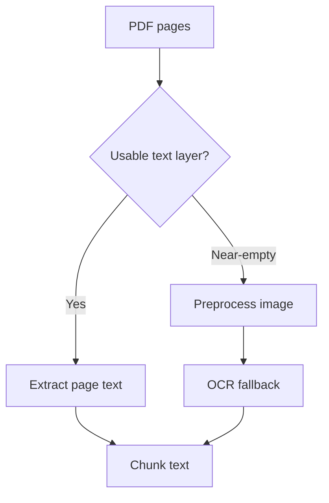
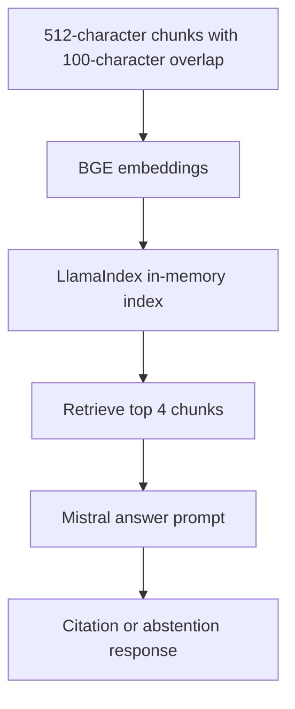
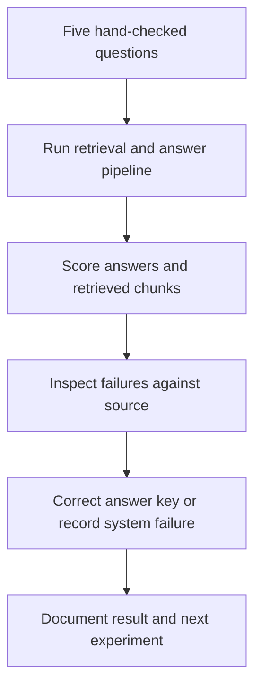

# AI Document Intelligence

AI Document Intelligence is the public edition of my Pfizer externship work: a set of document AI experiments covering OCR comparison, embedding and retrieval evaluation, and document question answering. I checked the historical pipeline against five hand-checked questions over a 10-page, 28-chunk test set, then used answer-key validation and error analysis to separate retrieval failures from ground-truth errors. The central question is practical: can the system retrieve grounded answers from mixed PDF documents, and where does it fail?

**Start here:** [final pipeline evaluation](docs/final-pipeline-evaluation.md), [OCR comparison](docs/ocr-engine-comparison.md), and the [public fixture run](docs/public-fixture-run.md).

## What this demonstrates

| Concept | How it is implemented or evaluated | Where to look |
| --- | --- | --- |
| OCR comparison | Pages with usable digital text are extracted directly; near-empty pages fall back to preprocessing and OCR. Tesseract, PaddleOCR, and EasyOCR are compared. | [`docs/ocr-engine-comparison.md`](docs/ocr-engine-comparison.md), [`notebooks/06-layout-ocr-engine-comparison.ipynb`](notebooks/06-layout-ocr-engine-comparison.ipynb) |
| Embedding and retrieval evaluation | The historical pipeline chunks text, embeds it, retrieves top-four context from a LlamaIndex in-memory index, and compares a baseline with a cross-encoder reranking configuration. | [`docs/final-pipeline-evaluation.md`](docs/final-pipeline-evaluation.md), [`docs/embedding-model-comparison.md`](docs/embedding-model-comparison.md), [`docs/rag-retrieval-configuration-comparison.md`](docs/rag-retrieval-configuration-comparison.md) |
| Document question answering | A source-grounded prompt asks for citations and abstention on weak context while the retrieved passages remain separately measurable. | [`docs/final-pipeline-evaluation.md`](docs/final-pipeline-evaluation.md), notebooks 08-20 |
| Evaluation and retrieval metrics | Answer-key validation reports Exact Match, Retrieval Recall@4, MRR, Precision@4, retrieval time, and full-query latency. | [`docs/final-pipeline-evaluation.md`](docs/final-pipeline-evaluation.md) |
| Error analysis | The repository preserves wrong-document retrieval, reranker context loss, answer truncation, and identifier errors as findings. | [`docs/`](docs/) |
| Fictional public demo | A fictional PDF fixture, checked answer key, offline reference demo, and tests run without original documents or API credentials. | [`data/public-fixtures/`](data/public-fixtures/), [`scripts/offline_demo.py`](scripts/offline_demo.py) |

## The journey from PDF to checked answer

1. I compared direct text extraction with OCR because one document set can include both digital and scanned pages.
2. I tested OCR for text coverage, layout grouping, confidence signals, and setup cost; one engine-reported confidence number is not treated as general accuracy.
3. The historical end-to-end pipeline used PyPDF2 extraction, Tesseract fallback, 512-character chunks with 100-character overlap, `BAAI/bge-small-en-v1.5` embeddings, a LlamaIndex in-memory index, `similarity_top_k=4`, and Mistral-7B-Instruct through `llama-cpp-python`.
4. I checked five answers against a source-reviewed answer key, then investigated the failures rather than treating the first score as final.

### 1. OCR and text preparation



On one scanned certificate page, Tesseract returned 220 words, PaddleOCR returned 36 regions, and EasyOCR returned 47 regions. PaddleOCR had the highest engine-reported average confidence (98.41%) and preserved a sampled field/value grouping; Tesseract had 93.90% reported confidence and more complete text. Those counts use different units, so the comparison is scoped to this document rather than a general OCR ranking.

### 2. Retrieval and answer generation



The pipeline includes a source-grounded prompt, but retrieval and generation remain separate things to evaluate. A generic lot-number question returned a real value from the wrong certificate; document type alone could not disambiguate two certificates of the same type. A future version needs a stable document identifier, page-range selection, or a clarification question.

### 3. Evaluation loop



## Results

| Historical evaluation: 5 questions, 10 pages, 28 chunks | Result |
| --- | ---: |
| Exact Match | 100% |
| Retrieval Recall@4 | 100% |
| MRR | 0.87 |
| Precision@4 | 45% |
| Retrieval time | about 88 ms |
| Full-query average | about 292 seconds |

Two apparent misses were answer-key errors. After checking the source, the same run changed from 80% to 100% Exact Match and from 60% to 100% Recall@4. Precision@4 remained 45%: the correct passage was retrieved for every question, but irrelevant context still appeared too often. The 292-second average came from local Mistral inference and is not suitable for an interactive chat experience.

## Run the public demonstration

```bash
python3 -m venv .venv
source .venv/bin/activate
python -m pip install -r requirements-demo.txt
python3 scripts/create_public_fixture.py
python3 -m unittest discover -s tests -v
python3 scripts/offline_demo.py
```

The public demo is a deterministic lexical reference implementation over fictional certificates. It checks source selection, extractive answers, and a clarification request for an ambiguous lot-number question; it does not rerun the historical embedding or Mistral evaluation.

## Repository map

| Path | Purpose |
| --- | --- |
| [`docs/`](docs/) | Findings, provenance, comparisons, and error analysis |
| [`notebooks/`](notebooks/) | Numbered historical experiments and public adaptations |
| [`data/public-fixtures/`](data/public-fixtures/) | Public PDFs, checked questions, and recorded checks |
| [`scripts/`](scripts/) | Fixture generator and offline demonstration |
| [`tests/`](tests/) | Public-fixture checks |

## Current status

- Original supplied documents and the historical answer key are not in this public edition.
- The final model pipeline was not rerun for the public release. Notebooks 19 and 20 retain their documented runtime and GPU requirements.
- The project is an evaluation of document-AI approaches, not a production Pfizer system.

## Ownership

I ran the evaluation, comparisons, and error analysis and directed the implementation.
